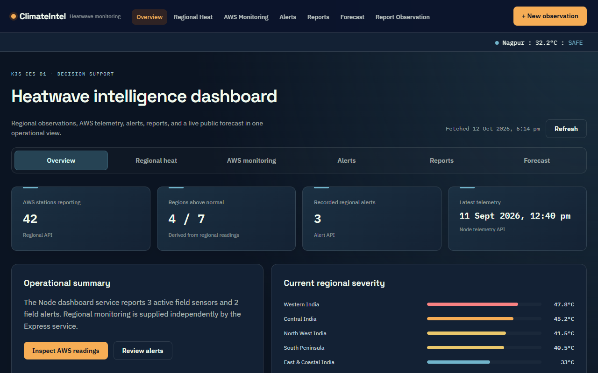
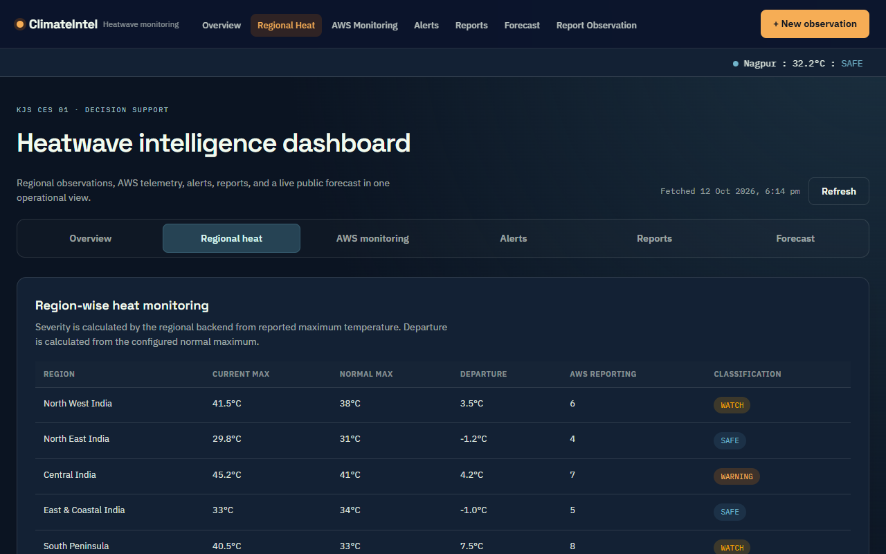
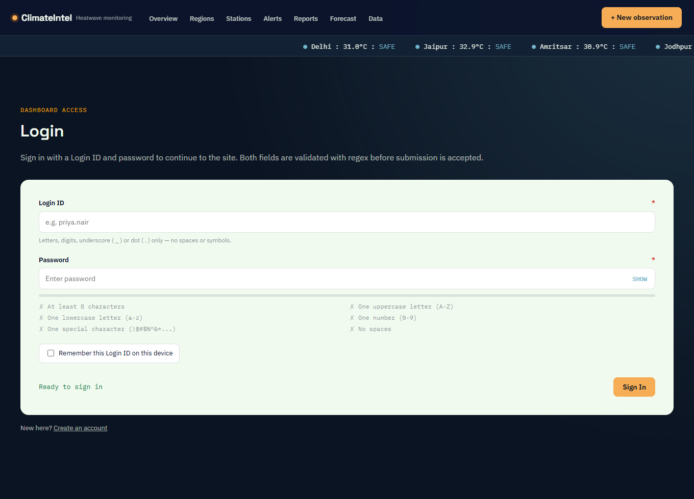

# ClimateIntel — Heatwave Monitoring Dashboard (KJS-CES-01)

A full-stack learning project: a **React + React Router** front end for regional heatwave monitoring, backed by three small
back ends that each demonstrate a different Node.js technique (core `http` module, Express Router, Express + MongoDB).

The use case is **KJS-CES-01 — Climate Intelligence for Heatwave Monitoring, Prediction and Early Warning** (collaborating
organisation: India Meteorological Department). India is split into 7 IMD regions; Automated Weather Stations (AWS) report
the maximum temperature of each region, and the system raises alerts in four tiers: **Safe → Watch → Warning → Emergency**.

> This is a coursework prototype (Web Programming-II lab). All data in the repository is **sample data**; there is no
> authentication, no real user data and no secret keys anywhere in the code.

---

## Table of contents

1. [Screenshots](#1-screenshots)
2. [Features](#2-features)
3. [Tech stack](#3-tech-stack)
4. [Architecture](#4-architecture)
5. [Folder structure](#5-folder-structure)
6. [Getting started](#6-getting-started)
7. [npm scripts](#7-npm-scripts)
8. [Front end in detail](#8-front-end-in-detail)
9. [Back ends in detail](#9-back-ends-in-detail)
10. [REST API reference](#10-rest-api-reference)
11. [MongoDB part (Exp-7)](#11-mongodb-part-exp-7)
12. [Configuration](#12-configuration)
13. [Form validation rules](#13-form-validation-rules)
14. [Testing the project](#14-testing-the-project)
15. [Security and privacy notes](#15-security-and-privacy-notes)
16. [Troubleshooting](#16-troubleshooting)
17. [Further documentation](#17-further-documentation)

---

## 1. Screenshots

| Home | Dashboard |
|---|---|
|  |  |

| Regional heat | Report an observation |
|---|---|
|  |  |

| Login (live password checklist) | Mobile companion (`/m`) |
|---|---|
|  |  |

## 2. Features

- **Landing page** that explains the system, with a live temperature ticker.
- **Dashboard** with six tabs: Overview, Regional heat, AWS monitoring, Alerts, Reports and Forecast. Numbers on it come
  from the real back ends (not hard-coded) and the Forecast tab calls the public Open-Meteo API.
- **Report an observation** form with full validation (name, e-mail, phone, temperature, URL, date, photo evidence, etc.).
- **Login** and **Register** forms with different validation styles (a strict password policy with a live strength
  checklist, and a minimal “name / e-mail contains @ / password ≥ 6” version).
- **In-page editing patterns**: inline edit, table-row edit, overlay edit, drag-and-drop reordering of cards, input
  overlay hints, list inlays, forgiving and structured input formats.
- **Mobile companion** at `/m`: a phone-sized, bottom-navigation view of the alerts.
- **Three independent back ends** (Node core `http`, Express Router with JSON files, Express with MongoDB).
- Clear error handling everywhere: loading states, API-down messages, HTTP 400 / 404 / 409 / 500 responses.

## 3. Tech stack

| Layer | Technology |
|---|---|
| Front end | React 18, React Router 6, Vite 5 (plain CSS with design tokens) |
| Back end 1 | Node.js core modules: `http`, `url`, `fs/promises` |
| Back end 2 | Express 4, `cors`, JSON-file storage |
| Back end 3 | Express 4, `cors`, MongoDB native driver 7 |
| Database | MongoDB (local, optional – only for `api-mongo/`) |
| External data | [Open-Meteo](https://open-meteo.com) forecast API (free, **no API key**) |

Requires **Node.js 18 or newer** (developed on Node 20).

## 4. Architecture

```
                         ┌──────────────────────────┐
   Browser  ───────────► │ React app (Vite, :5173)  │
                         └───────┬──────────┬───────┘
              /dashboard, /report│          │ forecast & ticker
                                 │          ▼
                                 │   Open-Meteo public API
                 ┌───────────────┴───────────────┐
                 ▼                               ▼
   Node core `http` API (:8100)      Express Router API (:4100)
   farmers · plots · sensors ·       regions · alerts
   alerts · reports (JSON files)     (JSON files)

   Stand-alone, used by the Exp-7 lab:
   Express + MongoDB API (:4200)  ──►  MongoDB  (database "climateintel")
```

The React app talks to the first two back ends through [src/api/backend.js](src/api/backend.js). The MongoDB API is a
separate service with the same kind of resources (regions, alerts) stored in a real database.

## 5. Folder structure

```
kjs-ces-01-forms-nav/
├── index.html                 Vite entry page
├── vite.config.js
├── package.json
├── .env.example               optional settings (copy to .env)
├── src/
│   ├── main.jsx, App.jsx      app bootstrap and routes
│   ├── api/
│   │   ├── backend.js         fetch wrappers for the Node and Express APIs
│   │   └── weather.js         Open-Meteo calls
│   ├── pages/                 Home, Dashboard, ReportForm, Login, Register,
│   │                          InPageEditing, StayOnPage, MobileHome, NotFound
│   ├── components/            Navbar, Footer, Ticker, Badge, InPageEdit
│   ├── hooks/useDragReorder.js
│   └── styles/global.css
├── api/                       Back end 1 – Node core http server (port 8100)
│   ├── server.js
│   └── data/*.json            farmers, plots, sensors, alerts, reports (sample data)
├── api-express/               Back end 2 – Express Router demo (port 4100)
│   ├── server.js, store.js
│   ├── routes/regions.js, routes/alerts.js
│   └── data/*.json
├── api-mongo/                 Back end 3 – Express + MongoDB (port 4200)
│   ├── db.js                  shared connection helper
│   ├── create_db.js, read.js, update.js, delete.js   CRUD scripts
│   ├── server.js              REST API
│   └── out/                   captured outputs of a real run
├── scripts/dev-all.js         starts both JSON back ends and Vite together
├── docs/screenshots/          images used in this README
└── *.md                       design and concept notes (see section 17)
```

## 6. Getting started

```bash
# 1. install dependencies
npm install

# 2. start the front end and the two JSON back ends together
npm run dev:all
```

Then open **http://localhost:5173**.

Prefer separate terminals? Run these in three terminals:

```bash
npm run dev           # React app          → http://localhost:5173
npm run api           # Node core API      → http://localhost:8100
npm run api-express   # Express Router API → http://localhost:4100
```

**Run the dashboard on MongoDB** (needs MongoDB running on `127.0.0.1:27017`, see [section 11](#11-mongodb-part-exp-7)):

```bash
npm run mongo:create  # once: create database "climateintel" and load sample data
npm run dev:mongo     # Node API + MongoDB API (:4200) + React app, wired together
```

Then open http://localhost:5173. The dashboard's regions and alerts now come from MongoDB, and an alert saved in the
dashboard shows up in MongoDB Compass.

Production build: `npm run build` (output in `dist/`), preview it with `npm run preview`.

## 7. npm scripts

| Script | What it does |
|---|---|
| `dev` | Vite dev server (port 5173) |
| `dev:all` | Starts Vite + Node API + Express (JSON files) API together; `Ctrl+C` stops all |
| `dev:mongo` | Same, but the dashboard uses the MongoDB API (:4200) instead of the JSON-file Express API |
| `build` / `preview` | Production build / serve the build |
| `api` (`dev:api`) | Node core `http` API on 8100 |
| `api-express` | Express Router API on 4100 |
| `api-mongo` | Express + MongoDB API on 4200 |
| `mongo:create` | Drop and re-create the `climateintel` collections and insert sample data (`insertMany`) |
| `mongo:read` | Hotspot query (`$gte` 44 °C), Emergency alerts, aggregation per tier |
| `mongo:update` | `updateOne` / `updateMany` with `$set` and `$inc` |
| `mongo:delete` | `deleteOne` an expired alert |

## 8. Front end in detail

### Routes

| Path | Page | Purpose |
|---|---|---|
| `/` | Home | Landing page, system explanation, live ticker |
| `/dashboard` | Dashboard | Tabs: `overview`, `regions` (Regional heat), `field` (AWS monitoring), `alerts`, `reports`, `forecast`. Use `?tab=` to deep-link, e.g. `/dashboard?tab=regions` |
| `/report` | ReportForm | Observation form with validation, saved through `POST /reports` |
| `/login` | Login | Strict password policy with live checklist and strength bar |
| `/register` | Register | Minimal registration validation |
| `/editing-demo` | InPageEditing | Gallery of the in-page editing patterns |
| `/stay-on-page` | StayOnPage | Demonstrates staying on the page after submit |
| `/m` | MobileHome | Phone-style alert list with bottom navigation |
| `*` | NotFound | 404 page |

### Data flow

1. A page mounts and calls a function from `src/api/backend.js` (`nodeApi.dashboard()`, `expressApi.regions()`, …).
2. Every request has a 15-second timeout and turns non-2xx responses into readable error messages.
3. The page shows a loading state, then data, or a clear “service not reachable” message if a back end is down.
4. Temperatures for the ticker and the Forecast tab are fetched live from Open-Meteo (`src/api/weather.js`).

## 9. Back ends in detail

### `api/` — Node core `http` (port 8100)
Written without any framework to show how `http`, `url` and `fs/promises` work: manual routing on `pathname`, JSON
responses, CORS headers, 404/500 handling and body parsing. `POST /reports` validates the body (required `plotId`,
`region`, `status`; temperature −10…60 °C; optional image must be a `data:image/jpeg|png|webp;base64,` URL up to 7 MB)
and answers **400** with a message when it is wrong. See [api/README.md](api/README.md).

### `api-express/` — Express Router (port 4100)
Modular routing with `express.Router()`: `routes/regions.js` (full CRUD, severity computed from temperature) and
`routes/alerts.js`, a small JSON store (`store.js`), request-logging middleware, a 404 handler and a central error
handler. Validation errors return **400** with an `errors` array.

### `api-mongo/` — Express + MongoDB (port 4200)
Same ideas, but data lives in MongoDB (see section 11). Invalid ids and bodies return **400**, unknown ids **404**.

## 10. REST API reference

### Node core API — `http://localhost:8100`

| Method & path | Description |
|---|---|
| `GET /` , `GET /health` | Service overview / health check |
| `GET /farmers` , `/plots` , `/sensors` | Sample records |
| `GET /irrigation?plotId=SG-1045` | Irrigation recommendation for a plot |
| `GET /prediction?plotId=SG-1045` | Next-irrigation prediction |
| `GET /water-stress?plotId=SG-1045` | Water-stress analysis |
| `GET /alerts` | Field alerts |
| `GET /dashboard` | Summary used by the dashboard cards |
| `GET /reports` , `POST /reports` | List / save an observation (201, or 400 if invalid) |

### Express Router API — `http://localhost:4100`

| Method & path | Description |
|---|---|
| `GET /api/regions` , `GET /api/regions/:id` | List / one region (with computed `severity`) |
| `POST /api/regions` | Create (400 on invalid body) |
| `PUT /api/regions/:id` , `PATCH /api/regions/:id` | Replace / partially update |
| `DELETE /api/regions/:id` | Delete (404 if missing) |
| `GET /api/alerts` , `GET /api/alerts/:id` | List / one alert |
| `POST /api/alerts` | Create; `tier` must be Safe, Watch, Warning or Emergency |
| `DELETE /api/alerts/:id` | Delete |

### MongoDB API — `http://localhost:4200`

| Method & path | Description |
|---|---|
| `GET /` | Service overview |
| `GET /api/regions` | All regions with severity |
| `GET /api/hotspots` | Regions with `currentMaxTempC ≥ 44` (a `$gte` query), hottest first |
| `GET /api/alerts` | All alerts |
| `POST /api/alerts` | `insertOne` after validation → 201 / 400 |
| `PATCH /api/alerts/:id` | `findOneAndUpdate` → 200 / 404 |
| `DELETE /api/alerts/:id` | `deleteOne` → 200 / 404 |

Severity bands used everywhere: **< 40 °C Normal · ≥ 40 Hot Day · ≥ 44 Heatwave · ≥ 47 Severe Heatwave**.

Quick example:

```bash
curl -X POST http://localhost:4100/api/alerts \
  -H "Content-Type: application/json" \
  -d '{"region":"Western India","tier":"Emergency","message":"Severe heatwave expected"}'
```

## 11. MongoDB part (Exp-7)

Database **`climateintel`**, three collections:

| Collection | Contents |
|---|---|
| `regions` | 7 IMD regions with normal/current max temperature and AWS count |
| `alerts` | Heatwave alerts (id, region, tier, message, channel, issued) |
| `observations` | AWS readings per station |

How the CRUD operations map to the use case:

| CRUD | Method | Meaning |
|---|---|---|
| Create | `insertMany()` | Load regions, alerts and observations |
| Read | `find()`, `sort()`, `aggregate()` | Hotspots ≥ 44 °C, Emergency alerts, alerts per tier, average reading |
| Update | `updateOne()`, `updateMany()`, `$set`, `$inc` | Escalate an alert, add an AWS station, flag readings ≥ 45 °C |
| Delete | `deleteOne()` | Remove an expired Watch alert |

Run the scripts in order (`mongo:create → mongo:read → mongo:update → mongo:read → mongo:delete`). A real captured run is
saved in [api-mongo/out/all_runs.txt](api-mongo/out/all_runs.txt). Inspect the data with MongoDB Compass at
`mongodb://localhost:27017`.

### Using MongoDB from the dashboard

What has to be in place:

1. **MongoDB running locally** on port 27017 – install MongoDB Community Server (it runs as a Windows service named
   `MongoDB`), or start one with Docker: `docker run -d -p 27017:27017 --name mongo mongo`.
2. **Sample data loaded once**: `npm run mongo:create` (creates `climateintel` with `regions`, `alerts`, `observations`;
   it **drops and re-creates** those collections, so do not run it if you want to keep changes).
3. **Start in Mongo mode**: `npm run dev:mongo`. This runs the MongoDB API on port 4200 and starts the React app with
   `VITE_EXPRESS_API_URL=http://localhost:4200`, so the dashboard reads and writes regions and alerts in MongoDB.
4. **Look at the data**: open MongoDB Compass, connect to `mongodb://localhost:27017` and open `climateintel`.

Only **regions and alerts** live in MongoDB. Farmers, plots, sensors and submitted observation reports are still served
by the Node API from the JSON files in `api/data/`. To use a different MongoDB, set `MONGO_URI` (for example an Atlas
connection string) before starting; never commit a connection string that contains a password.

## 12. Configuration

Everything has a working default, so **no `.env` file is required**. To change something, copy
[.env.example](.env.example) to `.env`:

| Variable | Default | Used by |
|---|---|---|
| `VITE_NODE_API_URL` | `http://localhost:8100` | React app |
| `VITE_EXPRESS_API_URL` | `http://localhost:4100` | React app (`dev:mongo` sets it to `http://localhost:4200`) |
| `MONGO_URI` | `mongodb://127.0.0.1:27017` | `api-mongo/` |
| `PORT` | 8100 / 4100 / 4200 | each back end |

`.env` files are git-ignored.

## 13. Form validation rules

- **Name** – letters only, words separated by a single space, hyphen or apostrophe.
- **E-mail** – standard pattern; **phone** – Indian 10-digit mobile (`^[6-9]\d{9}$`), non-digits are stripped while typing.
- **Login ID** – 4–20 characters, letters and digits, with `_` or `.` allowed inside (not at the ends); **password** – ≥ 8 characters with upper, lower, digit and symbol, no spaces
  (a live checklist and a strength bar show progress).
- **Register** – name not empty, e-mail contains `@`, password ≥ 6 characters (the exact lab wording).
- **Observation** – temperature −10…60 °C, valid URL/date, optional JPEG/PNG/WebP photo (≤ 7 MB).
- Every error message starts with a code such as `ERR_REQUIRED`, `ERR_INVALID_PHONE`, `ERR_WEAK_PASSWORD`.

The server repeats the important checks, so invalid data is rejected even if someone bypasses the form.

## 14. Testing the project

There is no automated test suite; the project was verified manually and with scripts:

```bash
npm run build                                   # compiles all 51 modules
curl http://localhost:8100/health               # {"status":"ok","service":"kjs-ces-01-node-backend","port":8100}
curl http://localhost:4100/api/regions          # 7 regions
curl -X POST http://localhost:4100/api/alerts -H "Content-Type: application/json" -d '{"tier":"Bad"}'   # 400
```

Open every route listed in section 8 and confirm that the browser console shows no errors.

## 15. Security and privacy notes

- No API keys, passwords, tokens or `.env` files are committed; Open-Meteo needs no key.
- Sample data only. Phone numbers in `api/data/farmers.json` are masked (`+91 XXXXX XXXXX`), names are fictitious.
- The Login/Register pages validate input **in the browser only** – there is no real authentication. Do not deploy this as
  a real login system.
- CORS is open (`cors()`) and MongoDB is used without credentials because everything is meant for **local development**.
  Restrict origins and enable MongoDB authentication before any public deployment.
- Uploaded photos are only accepted as base64 data URLs of three image types and are size-limited.

## 16. Troubleshooting

| Problem | Fix |
|---|---|
| Dashboard says a service is not reachable | Start the back ends (`npm run dev:all`) |
| `EADDRINUSE` on a port | Another process uses it – stop it or set `PORT=…` |
| `MongoServerSelectionError` / Mongo API does not start | MongoDB is not running – start the `MongoDB` service (or the Docker container), or use `npm run dev:all` instead |
| Dashboard still shows the old JSON data | You started with `dev:all`; stop it and run `npm run dev:mongo` |
| Blank page / stale code after pulling | Delete `node_modules` and `dist`, then `npm install` |
| Forecast tab empty | No internet – Open-Meteo is the only external call |

## 17. Further documentation

- [CODEBASE_GUIDE.md](CODEBASE_GUIDE.md) – file-by-file walkthrough of the front end
- [CONCEPTS_GUIDE.md](CONCEPTS_GUIDE.md) – React / forms concepts explained with examples from this code
- [IMPLEMENTATION.md](IMPLEMENTATION.md) and [EXPLANATION.md](EXPLANATION.md) – how each lab requirement was implemented
- [PROJECT_EXPLANATION.md](PROJECT_EXPLANATION.md) – project goals and structure
- [design.md](design.md) – design blueprint (layout, palette, components)
- [api/README.md](api/README.md) – Node core API notes
