# ClimateIntel — Live Heatwave Monitoring for India (KJS-CES-01)

A full-stack project that collects **real weather data** for 30 Indian cities from the free, public
[Open-Meteo](https://open-meteo.com) API, **stores it in MongoDB**, classifies heat conditions with IMD-style heatwave
rules, raises automatic alerts, and shows everything in a React dashboard, today's picture **and the days before it**.

- **No dummy data on the dashboard.** Every number comes from Open-Meteo, is saved in MongoDB, and is read back from there.
- **No API key, no account.** Open-Meteo is free for non-commercial use; the data licence is CC BY 4.0.
- **History survives refreshes and restarts.** Reload the page, or stop and restart the server: the stored readings are still there.

> Coursework prototype (Web Programming-II lab, collaborating organisation in the use case: India Meteorological Department).
> The values are model data for one point per city, **not** measurements from IMD weather stations, and the heat levels are an
> indicative classification, **not** an official warning. Use IMD bulletins for real decisions.

---

## Table of contents

1. [Screenshots](#1-screenshots)
2. [What it does](#2-what-it-does)
3. [Quick start](#3-quick-start)
4. [How the data flows](#4-how-the-data-flows)
5. [The data model (collections)](#5-the-data-model-collections)
6. [How the numbers are made](#6-how-the-numbers-are-made)
7. [Dashboard pages](#7-dashboard-pages)
8. [REST API reference](#8-rest-api-reference)
9. [Folder structure](#9-folder-structure)
10. [Tests](#10-tests)
11. [Credits](#11-credits)

---

## 1. Screenshots

| Home | Overview |
|---|---|
| 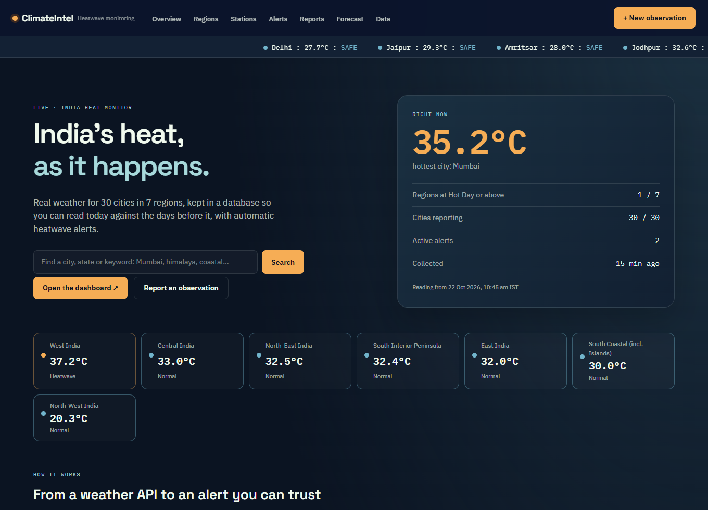 | 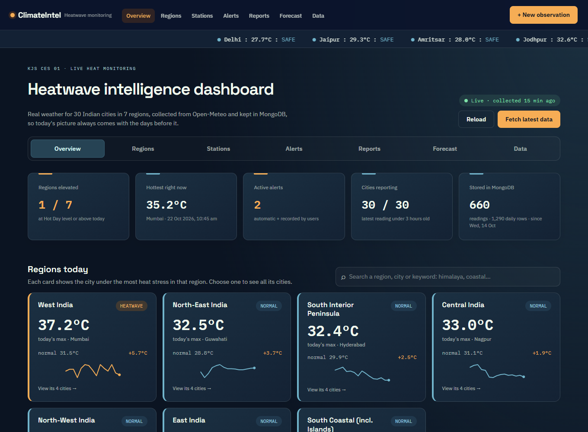 |

| Regions: 30-day history, normal, forecast | Stations: stored readings |
|---|---|
| 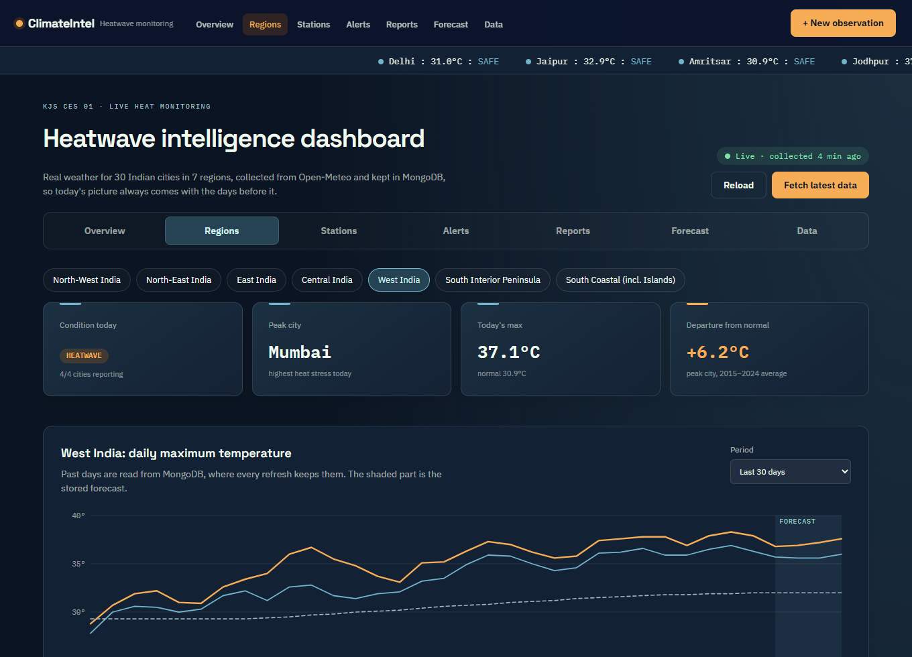 | 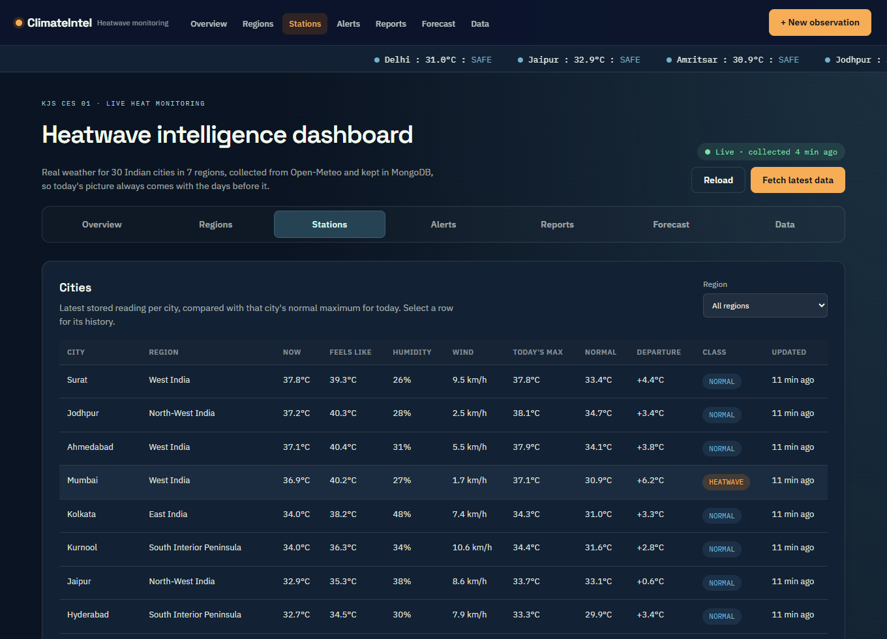 |

| Alerts | Forecast |
|---|---|
| 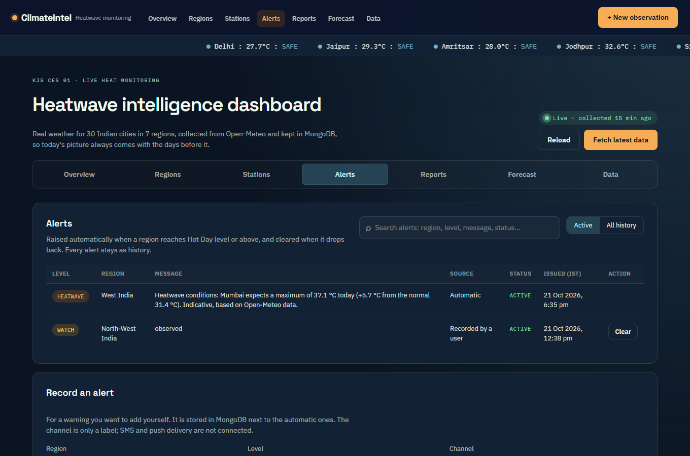 | 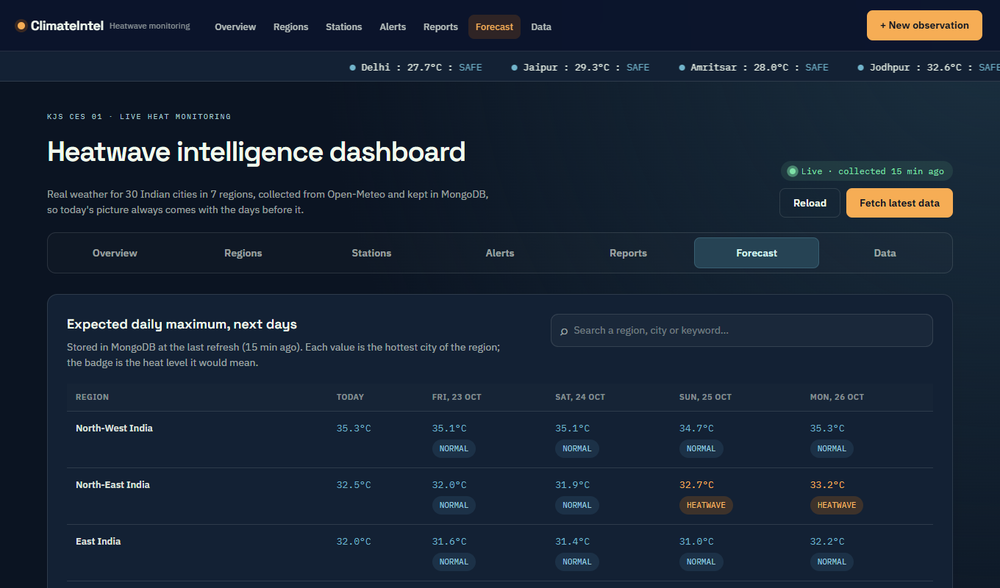 |

| Data: what MongoDB holds | Observation report form |
|---|---|
| 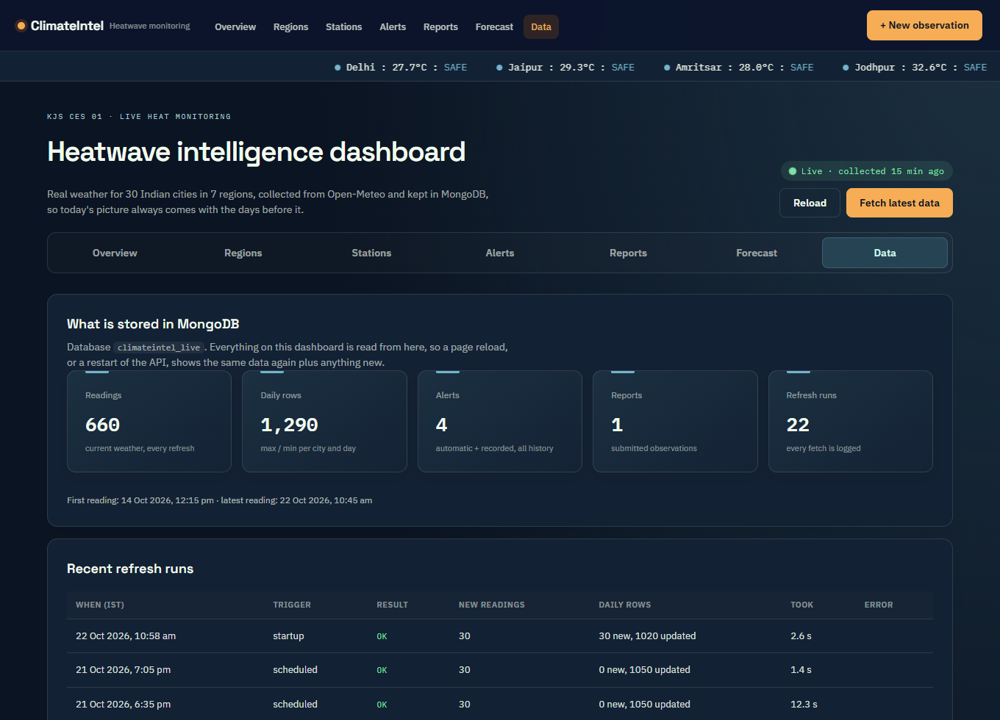 | 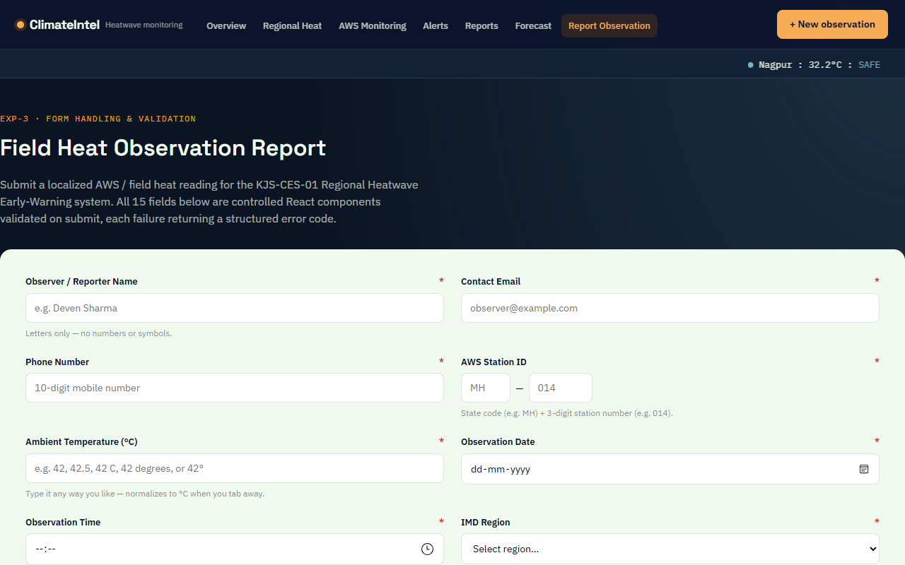 |

| Mobile companion (`/m`) | A region's cities on a phone |
|---|---|
| 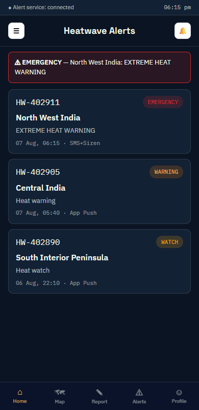 | 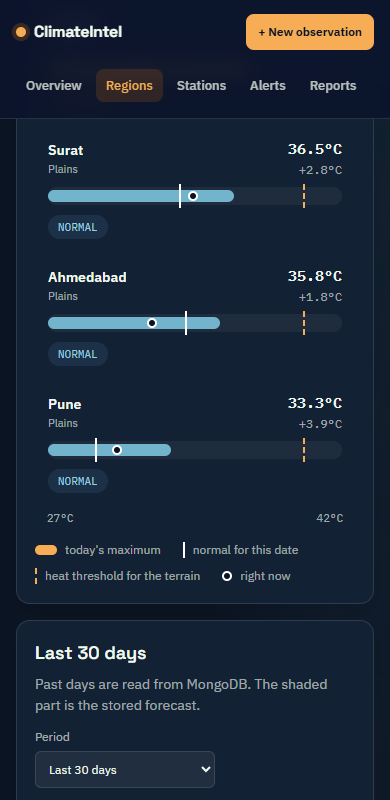 |

## 2. What it does

- Fetches current weather, the past 30 days and a 5-day forecast (today + 4) for **30 cities in 7 regions** every 30 minutes.
- Saves every reading in MongoDB, so the history grows over time and is never overwritten.
- Compares each city's daily maximum with **its own multi-year normal** and classifies it: Normal, Hot Day, Heatwave, Severe Heatwave.
- Raises an **automatic alert** per region when the level changes, and marks it cleared when the region returns to normal. All alerts stay as history.
- Dashboard with seven tabs: Overview, Regions, Stations, Alerts, Reports, Forecast, Data.
- **Search everywhere**: Overview, Regions, Stations, Forecast, Alerts and Reports each have a search box (and the home page has "find a city"). The matching runs in MongoDB, and the text is kept in the address bar.
- **Choose a region and see its cities** compared on one scale: today's maximum, the city's normal, its heat threshold and the current reading.
- Lets users **record their own alerts** and **submit observation reports** (validated, stored in MongoDB).
- Mobile companion page, a live ticker, and a clear "data" tab that shows exactly what is stored and how it is computed.

## 3. Quick start

You need Node.js 18+, MongoDB running on your computer and an internet connection. Then, from the project folder:

```bash
cd kjs-ces-01-forms-nav
npm install          # first time only
npm run dev:all      # backend on port 4300, website on port 5173
```

Open **http://localhost:5173**.

## 4. How the data flows

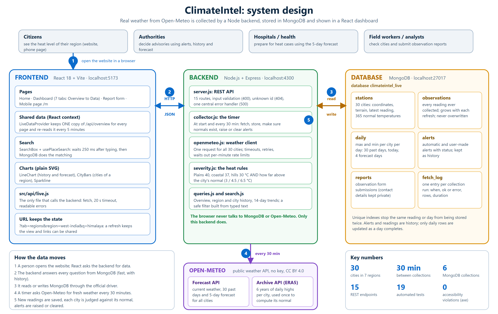

```
Open-Meteo (public API) ──every 30 min──► live API (Node + Express, port 4300) ──► MongoDB "climateintel_live"
                                                   ▲                                        │
                                                   └──────────── reads everything ──────────┘
                                                   │
                                          React app (port 5173)   ← the browser never calls Open-Meteo itself
```

1. **Collect.** On start, and every 30 minutes (`REFRESH_MINUTES`), the collector makes one request to Open-Meteo for all 30 cities.
   If the last successful run was less than 30 minutes ago, it serves the stored data and waits.
2. **Store.** New readings are inserted (never overwritten); daily rows are updated as a day completes; every run is logged.
3. **Evaluate.** Each city is classified against its normal; each region takes the level of its worst city; alerts are raised or cleared.
4. **Serve.** The React app asks the live API, which answers from MongoDB. The "Fetch latest data" button asks the API to collect right now.

## 5. The data model (collections)

| Collection | One document per | Contents |
|---|---|---|
| `stations` | monitoring city (30) | name, region, coordinates, terrain, latest reading, 365 "normal" daily maxima |
| `observations` | city and reading time | temperature, feels-like, humidity, wind, when it was observed and fetched. **Grows with every refresh** |
| `daily` | city and date | daily max/min/feels-like max; 30 past days plus today and 4 forecast days; `isForecast` flag |
| `alerts` | alert | region, level, message, source (`auto` or `manual`), status (`active`, `cleared`, `superseded`), times |
| `reports` | submitted report | the observation form data, optional image |
| `fetch_log` | refresh run | when, trigger, success, rows written, duration, error |

Indexes make `(stationId, observedAt)` and `(stationId, date)` unique, so a reading can never be stored twice.

## 6. How the numbers are made

- **Source.** Open-Meteo forecast API (current weather + daily values) and its archive API (ERA5 reanalysis, for the normals).
  Time zone is India Standard Time. 30 cities, 4 to 6 per region, one model point each.
- **Normal.** For each city and calendar day, the average daily maximum over **2019–2024**, smoothed over ±7 days
  (a 6-year average, not IMD's official 30-year normal). Computed once on first start and stored. The period is kept short because of
  Open-Meteo's free request limits.
- **Classification** (modelled on the IMD heat-wave criteria):

  | Level | Rule |
  |---|---|
  | Hot Day | maximum at or above the threshold and **3 °C or more** above normal |
  | Heatwave | at or above the threshold and **4.5 °C or more** above normal |
  | Severe Heatwave | at or above the threshold and **6.5 °C or more** above normal |

  Threshold by terrain: **plains 40 °C, coastal 37 °C, hills 30 °C**. Plains cities also count by absolute value: 45 °C = Heatwave, 47 °C = Severe.
- **Region level.** The level of its worst city (highest level, then biggest departure). The region card shows that city.
- **Alert tiers.** Hot Day → Watch, Heatwave → Warning, Severe Heatwave → Emergency; Normal → Safe (no alert).
- **"Today's max"** is the larger of Open-Meteo's expected maximum for today and the latest reading.
- **Seasonality.** Outside the hot season most cities are normal and there may be no alerts. That is the real situation, not a fault.

## 7. Dashboard pages

| Tab (`/dashboard?tab=…`) | Shows |
|---|---|
| `overview` | Five headline numbers, a card per region (with a 14-day sparkline; choose one to open it), hottest cities right now, latest alerts. Searchable |
| `regions` | Search box (region, city, state, keyword). Pick a region: its headline numbers, **its cities compared side by side**, a 30-day chart (hottest city, region average, normal) and a day-by-day table (shortened until you ask for all) |
| `stations` | Search box (for example `himalaya`, `coastal`, `Tamil Nadu`) and region filter. A short table of all 30 cities; select one for its facts (humidity, wind, normal, threshold), 30-day chart and stored readings |
| `alerts` | Search; active alerts or the full history; form to record an alert; clear your own alerts |
| `reports` | Search; observation reports stored in MongoDB (contact details are hidden and not searchable) |
| `forecast` | Search; expected daily maximum for the next days in every region, with the heat level it implies |
| `data` | Row counts in MongoDB, first/last reading, recent refresh runs, and the method |

Other routes: `/` home, `/report` observation form, `/m` mobile companion; any other address shows a 404 page.
Deep links work, for example `/dashboard?tab=regions&region=west-india` or `/dashboard?tab=stations&station=mumbai`.

## 8. REST API reference

Base URL `http://localhost:4300`. All responses are JSON; errors look like `{ "error": "…" }` or `{ "errors": ["…"] }`.

| Method & path | Description |
|---|---|
| `GET /api/health` | Pings MongoDB |
| `GET /api/overview` | Regions (with 14-day trend and forecast), cities, summary numbers, stored-data stats |
| `GET /api/search?q=himalaya` | Search cities by name, state, region, terrain or keyword (runs in MongoDB); returns matching cities and their regions |
| `GET /api/regions/:id/history?days=30` | Daily series for a region (1–90 days, includes forecast) |
| `GET /api/stations/:id/history?hours=48` | Stored readings (up to 90 days) and all daily rows for a city |
| `GET /api/alerts?status=active&q=heatwave&limit=100` | Alerts, newest first; `q` searches region, message, level, status and source in MongoDB |
| `POST /api/alerts` | Record an alert `{ region, tier, message, channel? }` → 201, or 400 with the reasons |
| `POST /api/alerts/:id/clear` | Mark an alert cleared → 200 / 404 |
| `GET /api/reports?q=mumbai` | Observation reports (no email/phone, no image data); `q` searches region, station code, status, observer and notes |
| `POST /api/reports` | Save a report (validated; region must be one of the 7) → 201 / 400 |
| `GET /api/reports/:id/photo` | The report's image, if any |
| `GET /api/stats` | Collection counts and first/last reading |
| `GET /api/runs?limit=20` | The refresh log |
| `POST /api/refresh` | Collect now → 200 with a summary, 429 if called again within a minute, 502 if Open-Meteo is unreachable |

Region ids: `north-west-india`, `north-east-india`, `east-india`, `central-india`, `west-india`, `south-interior-peninsula`, `south-coastal`.

```bash
curl -X POST http://localhost:4300/api/alerts -H "Content-Type: application/json" \
  -d '{"region":"West India","tier":"Warning","message":"Avoid outdoor work 12-4 pm"}'
```

## 9. Folder structure

```
kjs-ces-01-forms-nav/
├── live-api/                    Backend (Node + Express + MongoDB)
│   ├── server.js                15 REST routes, validation, error handling
│   ├── collector.js             timer; fetch → store → normals → alerts
│   ├── openmeteo.js             Open-Meteo client (timeouts, retries, rate-limit wait)
│   ├── queries.js               overview, history, trends, stats
│   ├── search.js                safe MongoDB filter built from typed text
│   ├── severity.js              heat rules, normals, India-time helpers (pure functions)
│   ├── db.js, config.js         connection and indexes / settings, 7 regions, 30 cities
│   └── *.test.js                19 unit tests (npm test)
├── src/                         Frontend (React + Vite)
│   ├── main.jsx, App.jsx        entry and page frame
│   ├── api/live.js              the only API client (talks to live-api)
│   ├── context/LiveData.jsx     shared overview data, re-read every 5 minutes
│   ├── hooks/                   usePlaceSearch, useDebouncedValue, usePageTitle
│   ├── pages/                   Home, Dashboard, ReportForm, MobileHome, NotFound
│   │   └── dashboard/           Overview, Regions, Stations, Alerts, Reports, Forecast, DataTab
│   ├── components/              Navbar, Ticker, Footer, Badge
│   │   └── live/                LineChart, CityBars, Sparkline, SearchBox, shared table/stat components
│   └── styles/                  global.css (base) + live.css (dashboard and home)
├── scripts/dev-all.js           starts live-api + Vite together
├── docs/                        screenshots and the system-design diagram used by this README
├── index.html, vite.config.js, package.json, .env.example
└── README.md
```

## 10. Tests

```bash
npm test      # 19 unit tests: search filter, Open-Meteo rate limits, heat levels for plains/coastal/hills, absolute 45/47 °C rule, missing data,
              # normals averaging and smoothing, 29 February handling, India-time helpers
npm run build # compiles the React app
```

The collector, MongoDB queries and every dashboard tab were also checked against the real Open-Meteo API and a real MongoDB:
a fetch stores new readings, a browser reload shows the same totals, a restart keeps the history, forms save to the database.

### Accessibility and usability

The interface was checked with the axe-core accessibility engine on 9 pages, on desktop and phone sizes: **0 violations**
(it found 8 kinds before the fixes below). What is in place:
- a "Skip to content" link, one `<h1>` per page with ordered headings, a descriptive browser title on every page;
- every form control has a name, text meets WCAG AA contrast, and colour is never the only signal (levels are also written as words);
- everything works with the keyboard (rows and pills are buttons, wide tables can be scrolled with the keyboard, visible focus ring);
- the layout adapts to phones with no sideways page scrolling, and animations stop for people who prefer reduced motion;
- progressive disclosure keeps screens calm: short tables with the extra detail one click away, long tables shortened until you ask.

## 11. Credits

Weather data by [Open-Meteo.com](https://open-meteo.com/), licensed under [CC BY 4.0](https://creativecommons.org/licenses/by/4.0/).
Heat levels are modelled on the heat-wave criteria of the India Meteorological Department (IMD); this project is not affiliated with IMD.
